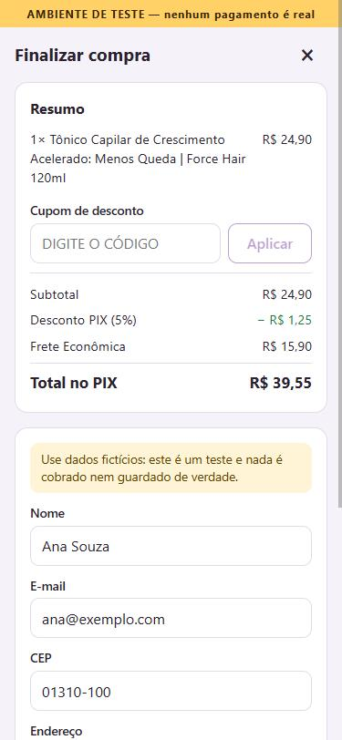
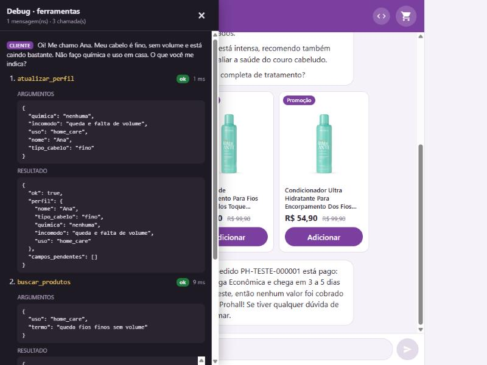

# Sofia Web Chat — vendedora IA Prohall

Vendedora virtual em chat web (estilo Sofia) para o teste técnico da Prohall. Ela conhece 15 produtos, recomenda pelo perfil da cliente, calcula frete por tabela fixa, monta o carrinho e fecha com checkout e PIX falsos.

O foco do projeto é IA aplicada a vendas: prompt, function calling, dados e limites. Frete, totais, cupom, estoque e PIX são calculados sempre no código; a IA só chama ferramentas e comunica os resultados.

| Os quatro pontos que o enunciado prioriza | Onde ver |
| --- | --- |
| Estrutura do prompt | [`prompts/sofia.md`](prompts/sofia.md) · [Prompt e limites](#prompt-e-limites) |
| Desenho das ferramentas | [`server/src/tools/`](server/src/tools) · [Ferramentas](#ferramentas) |
| Qualidade dos dados | [`data/produtos.json`](data/produtos.json) · [Preços](#preços-do-catálogo) · [Combinações](#combinações-combina_com) |
| Limites da IA | [`docs/conversas-teste.md`](docs/conversas-teste.md) · [Prompt e limites](#prompt-e-limites) |

## Como rodar

Requisitos: Node 20 ou superior e pnpm.

```bash
pnpm install
cp .env.example .env    # depois preencha a GEMINI_API_KEY (enviada separadamente; nunca commitar o .env)
pnpm dev                # sobe o servidor (3000) e a interface (5173)
```

Abra **http://localhost:5173**. O Vite encaminha `/api` para o servidor; se mudar a `PORT`, rode o web com `SERVER_PORT` igual.

| Variável | Descrição | Padrão |
| --- | --- | --- |
| `GEMINI_API_KEY` | Chave da API do Gemini | — (obrigatória) |
| `GEMINI_MODEL` | Modelo usado pela Sofia; o `.env.example` traz `gemini-3.8-flash` | — (obrigatória) |
| `GEMINI_TEMPERATURE` | Opcional. Temperatura (0 a 2); o `.env.example` traz `0.3`, para ser simpática e exata | padrão do modelo |
| `GEMINI_THINKING_LEVEL` | Opcional. `MINIMAL`, `LOW`, `MEDIUM` ou `HIGH`; o `.env.example` traz `LOW`, que responde mais rápido | padrão do modelo |
| `PORT` | Porta do servidor | `3000` |

Outros comandos:

| Comando | O que faz |
| --- | --- |
| `pnpm test` | Roda os 487 testes (Vitest); não chama o Gemini |
| `pnpm typecheck` | Confere os tipos do servidor, da interface e do pacote compartilhado |
| `pnpm chat` | Conversa com a Sofia no terminal, mostrando cada ferramenta; `/pagar` simula o pagamento (exige chave real) |
| `pnpm conversas [id…] [--vezes N]` | Roda as conversas-teste contra o Gemini e grava [`docs/conversas-teste.md`](docs/conversas-teste.md) (exige chave real) |
| `pnpm estoque:repor [n]` | Soma `n` unidades (padrão 10) ao estoque de todos os produtos |
| `pnpm validate:catalogo` | Valida `data/produtos.json` contra o schema e a variedade mínima do enunciado |
| `pnpm gemini:teste` · `pnpm gemini:ferramentas` | Chamada simples e chamada com function calling, para conferir a chave e o modelo |

Com `?debug` na URL (ou pelo botão `<>` do topo) a interface abre o painel de debug, que lista as ferramentas chamadas em cada mensagem, com argumentos e resultado.

## Como é a interface

<p>
  
  
  
  
</p>

Chat com cards e carrinho · checkout com faixa "AMBIENTE DE TESTE" · PIX falso com contador de 15 minutos · painel de debug.

## Como funciona

```
Interface (Svelte)  ──POST /api/chat (SSE)──▶  Agente  ◀──▶  Gemini
        │                                        │
        └── carrinho, checkout, PIX (REST)       ▼
                      │                      Ferramentas (zod)
                      └──────────────────────────┤
                                                 ▼
                          Domínio: frete, cupom, carrinho, totais (funções puras)
```

- **Agente** (`server/src/agent`): loop de function calling escrito à mão. A cada mensagem ele chama o Gemini, executa as ferramentas que ele pedir (várias de uma vez, se for o caso), devolve os resultados e repete até a resposta final, com limite de 8 rodadas. O texto sai em streaming.
- **Ferramentas** (`server/src/tools`): camada fina. Validam os argumentos com zod, chamam o domínio e devolvem JSON claro, com erros amigáveis (CEP inválido, estoque insuficiente, cupom abaixo do mínimo).
- **Domínio** (`server/src/domain`): dinheiro em centavos, CEP e zona, peso e faixa, frete, frete grátis, cupom, carrinho, totais, pedido e PIX. São funções puras, sem Fastify nem Svelte, e é onde estão os testes obrigatórios: as faixas de peso nos limites (1.000 g, 5,3 kg, 6,3 kg), as tabelas de frete e o exemplo 6.2, que dá exatamente **R$ 279,40**.
- **Estado**: carrinho, perfil e pedidos ficam em memória, por conversa. O que a cliente faz na tela (botão Adicionar, cupom, checkout) passa pelas mesmas regras das ferramentas e chega à Sofia como um aviso na próxima mensagem.
- **Logs**: cada mensagem e cada chamada de ferramenta, com argumentos, resultado e duração, vão para `logs/conversas.jsonl` (fora do Git).

## Ferramentas

| Ferramenta | O que faz |
| --- | --- |
| `buscar_produtos` | Lista resumida do catálogo, com filtros por termo, categoria e uso |
| `detalhar_produto` | Ficha completa; campo ausente volta como "sem informação" |
| `produtos_complementares` | O que combina com um produto (`combina_com` e kits) |
| `mostrar_produtos` | Mostra na tela os cards (foto, preço, Adicionar) dos 1 a 3 produtos recomendados |
| `atualizar_perfil` | Grava o que a cliente contou: nome, tipo de cabelo, química, incômodo, uso |
| `adicionar_ao_carrinho` | Valida id, estoque e o limite de 10 por item |
| `remover_do_carrinho` | Remove o item todo ou só uma parte; avisa se o cupom deixou de valer |
| `aplicar_cupom` | Valida o PROHALL10 (10%, mínimo de R$ 150,00 em produtos) |
| `ver_carrinho` | Itens, subtotal, cupom, frete e total no PIX de cada modalidade |
| `calcular_frete` | Zona, Econômica e Expressa com valor e prazo, e o gatilho do frete grátis |
| `finalizar_pedido` | Cria o pedido (aguardando pagamento) com os dados de entrega |
| `gerar_pix` | PIX falso de 15 minutos; só gera outro depois de expirar |
| `consultar_pedido` | Status do pedido e do PIX |

Valores em reais voltam como `{ centavos, texto }` e a Sofia copia o `texto`: ela não calcula nem formata. As declarações enviadas ao Gemini saem do mesmo schema zod que valida os argumentos.

## Prompt e limites

O prompt de sistema fica em [`prompts/sofia.md`](prompts/sofia.md), em oito blocos: persona, objetivo, roteiro de venda, regras de uso das ferramentas, gatilhos permitidos, limites, formato das respostas e catálogo resumido (sem preço nem estoque, que só vêm das ferramentas).

Os limites do enunciado estão no prompt e são conferidos por **10 roteiros** (`pnpm conversas`): fluxo completo, cliente indecisa, produto fora do catálogo, pedido de 50%, CEP inválido, prompt injection, cartão/boleto, problema de saúde, estoque baixo e produto profissional para uso em casa. Cada conversa também passa por verificações gerais: nenhum valor em R$ que não tenha vindo de uma ferramenta, nenhum pedido de CPF ou cartão, nenhuma urgência falsa, nenhum trecho do prompt, no máximo uma pergunta por mensagem e nenhum id interno de produto.

Última validação, com 3 execuções por roteiro (30 conversas): **29 passaram**; a falha foi uma mensagem com duas perguntas. O tempo até o primeiro texto ficou com mediana de **4,5 s** (antes dos ajustes de prompt, temperatura e pensamento, era de 8,5 s). O relatório completo, com as falas, as ferramentas e cada verificação, está em [`docs/conversas-teste.md`](docs/conversas-teste.md).

## API

Servidor em `http://127.0.0.1:3000` (porta de `PORT`).

- **Chat**: `POST /api/chat` com `{ "mensagem": "...", "sessaoId": "opcional" }` responde em Server-Sent Events: `sessao` (id da conversa), `texto` (pedaços), `ferramenta` (nome, argumentos, resultado), `fim` (texto completo) e `erro`. `GET /api/saude` responde `{ "ok": true }`.
- **Carrinho**: `GET /api/sessoes/:sessaoId/carrinho`, `POST …/carrinho/itens` (`{ id, quantidade? }`), `DELETE …/carrinho/itens/:produtoId?quantidade=n` e `POST …/cupom` (`{ codigo }`).
- **Frete**: `POST /api/sessoes/:sessaoId/frete` (`{ cep }`).
- **Checkout**: `POST /api/sessoes/:sessaoId/checkout` (nome, e-mail, CEP, endereço, número, complemento opcional e `modalidade_frete`) cria o mesmo pedido que a Sofia fecha pela conversa.
- **PIX**: `POST …/pedidos/:pedidoId/pix` (PIX falso com QR Code em SVG, 15 minutos), `POST …/pagar` (simula o pagamento e devolve a confirmação da Sofia) e `GET …/pedidos/:pedidoId`.
- **Estoque**: o pedido reserva as unidades enquanto o PIX vale; sem pagamento em 15 minutos elas voltam sozinhas. O estoque alterado fica em `data/estoque.json` (fora do Git), e o servidor no ar enxerga a reposição de `pnpm estoque:repor` sem reiniciar.

## Stack

Monorepo pnpm · Node + TypeScript + Fastify · Svelte + Vite · zod · Vitest · Gemini `gemini-3.8-flash` via `@google/genai`.

**Svelte + Vite no front.** Fica fora das sugestões do enunciado (HTML/JS ou React), então a justificativa importa:

- **É leve depois de compilado.** O Svelte compila os componentes para JavaScript puro, sem um framework rodando no navegador. A interface inteira (chat, cards, carrinho, checkout, PIX e painel de debug) sai do `vite build` com **80,6 KB de JS (28,5 KB com gzip) e 19,3 KB de CSS (4,2 KB com gzip)**.
- **É fácil de incorporar numa página de vendas.** Sendo pequena e autocontida, a interface pode virar um widget dentro de uma página de produto ou de campanha sem levar um framework junto. O Svelte também pode compilar o app como Web Component (uma tag que qualquer página aceita, em HTML puro, WordPress ou React); isso não foi feito aqui, mas é um caminho aberto.
- **Pouco código para o estado do chat.** Streaming, carrinho, checkout e PIX têm estado reativo; a lógica fica em TypeScript puro (`web/src/lib`), testada sem navegador, e os componentes só mostram.
- Descartados: SvelteKit fullstack (misturaria a lógica de IA com o framework), Next.js (mais pesado que o escopo) e HTML puro (estado do chat, do carrinho e do PIX à mão).

**Node + TypeScript + Fastify no back.** O SDK do Gemini é de primeira linha em TypeScript, os tipos são compartilhados com o front e o Fastify traz validação por schema. Descartados: Express (tipagem fraca), Hono (comunidade menor) e Python + FastAPI (duas linguagens, sem compartilhar tipos).

**Outras escolhas**
- **Monorepo com pnpm workspaces** e o pacote `@sofia/shared`: um clone, um README, tipos e schemas usados pelos dois lados.
- **zod** como fonte única: o mesmo schema valida os argumentos de cada ferramenta e gera o JSON Schema do function calling.
- **Loop de function calling escrito à mão**, sem Vercel AI SDK: a abstração esconderia justamente o loop que o teste quer ver.
- **Vitest** para o domínio, que roda como funções puras, sem Fastify nem Svelte.
- **Dinheiro em centavos inteiros**, formatado só na saída: o `number` do JS é ponto flutuante e o exemplo 6.2 precisa dar exatamente R$ 279,40.

## Preços do catálogo

Preços copiados de lojaprohall.com.br em **29/10/2026**. Os 15 preços (cheio e promocional) foram conferidos nas páginas dos produtos nessa data. Preço vigente = promocional quando existe.

## Combinações (`combina_com`)

Seis pares, nos dois sentidos em `data/produtos.json`, escolhidos por serem os que mais fazem sentido na ficha dos produtos:

- PH-001 + PH-002 · O tônico Force Hair cuida do couro cabeludo (queda, fios fracos) e o kit Encorpax repõe massa no comprimento de fios finos e ralos: raiz e fio no mesmo problema.
- PH-004 + PH-013 · Mesma linha Secar Sem Frizz: o sérum sela as cutículas antes de secar e o óleo de blindagem é a última etapa do protocolo, contra a umidade.
- PH-006 + PH-008 · O fluido Pro.R reconstrói fios fragilizados e o óleo Ambar finaliza selando a cutícula e dando brilho.
- PH-007 + PH-015 · O modo de uso do pó descolorante pede a mistura com Água Oxigenada Prohall; a OX 30 volumes é essa loção.
- PH-009 + PH-010 · Mesma linha Bruma Ametista: a ficha do shampoo indica usar o condicionador da linha em seguida.
- PH-011 + PH-012 · Mesma linha Aura Radiante: a ficha do shampoo indica usar o condicionador da linha em seguida.

## Limitações conhecidas e o que ficou de fora

- **Latência.** A mediana até o primeiro texto é de 4,5 s, acima dos cerca de 3 s do requisito. Quando a resposta envolve várias ferramentas, chega a 20 ou 30 s, porque cada rodada de ferramentas é uma nova chamada ao Gemini.
- **O modelo varia.** Em 3 execuções dos 10 roteiros, 29 de 30 passaram. A falha foi uma mensagem com duas perguntas, mesmo com o prompt pedindo uma.
- **Os cards dependem do modelo.** Eles aparecem quando a Sofia chama `mostrar_produtos`; se ela esquecer, a recomendação sai só em texto.
- **Memória.** Conversas, carrinhos e pedidos ficam em memória: reiniciar o servidor zera tudo (e a tela pede para recarregar). Só o estoque alterado persiste, em `data/estoque.json`.
- **Sem cancelamento de pedido.** Um pedido sem pagamento só devolve o estoque quando o PIX expira.
- **Dados do catálogo.** Os produtos da linha Secar Sem Frizz (PH-004, PH-013 e PH-014) não informam se são de uso profissional ou em casa (`uso: null`), então ficam fora do filtro de uso em casa; a Sofia avisa que não sabe. Algumas fichas têm campos que o site não informa, e a Sofia diz que não tem a informação.
- **Fotos** vêm direto do site da Prohall; sem internet, o card mostra só o nome.
- **Só PIX**, e falso. Sem cartão, boleto, login, nem cobrança real; um único cupom (PROHALL10).
- **Servidor só local**, escutando em `127.0.0.1`, sem autenticação nem limite de requisições.
- **Interface**: a lógica (chat, carrinho, pedido, markdown) tem testes; os componentes Svelte foram conferidos no navegador, sem testes automatizados. Não foi gerado o build como Web Component para incorporar em outra página.

## Decisões

**Como organizei o trabalho**

- **Documentos antes do código.** Separei o contexto em três arquivos: `docs/especificacao.md` (o enunciado, sem alterações, vale em caso de conflito), `docs/requisitos.md` (escopo, arquitetura e stack) e `docs/tarefas.md` (backlog). O `CLAUDE.md` resume as regras inegociáveis para o assistente de IA que usei no desenvolvimento.
- **35 tarefas em 10 fases**, na ordem de prioridade e dependência: setup, teste do Gemini, domínio, catálogo, ferramentas, agente, checkout e PIX, interface, avaliação e entrega. Cada tarefa tem objetivo, critério de aceite, dependências e mensagem de commit sugerida. Prevejo uma branch por fase; na prática consolidei em `feature/setup-webchat` e `feature/desenvolvimento-webchat`.
- **Prioridade pelo núcleo, interface por último.** O Gemini foi testado (chamada simples e function calling) antes de construir qualquer coisa em cima dele. A interface fica no fim porque o foco do teste é a IA aplicada a vendas.
- **Cálculo antes da IA.** Dinheiro, CEP, frete, cupom, carrinho e totais são funções puras com testes e ficaram prontos antes do prompt e das ferramentas. A IA só chama ferramentas e comunica o resultado.
- **Uma tarefa por vez, um commit por tarefa.** Uso a skill `/tarefa T-XX`: confere dependências, propõe o plano, implementa com testes, marca `[x]` no índice e entrega o resumo. O commit só sai depois da minha revisão, e o hash volta para o índice.
- **A CLI veio antes da interface.** O `pnpm chat` me permitiu conversar com a Sofia e ver cada ferramenta chamada sem esperar o front, e serve para rodar roteiros de teste.
- **Validação contra a API real.** Além dos testes com modelo roteirizado, conferi o function calling, o streaming e as conversas-teste com o Gemini de verdade, e usei a mediana do tempo até o primeiro texto como medida para ajustar o prompt.

**Escolhas de configuração e de processo**

- **Ambiguidade: decidir, seguir e registrar.** As decisões pontuais de cada tarefa ficam no histórico de commits; aqui só entram as que mudam a forma de trabalhar e a stack.
- **Sem padrões escondidos.** `GEMINI_API_KEY` e `GEMINI_MODEL` são obrigatórios no `.env` e lidos num único lugar (`server/src/config.ts`); sem eles tudo para com uma mensagem clara. Temperatura e nível de pensamento são opcionais: sem valor, vale o padrão do modelo.
- **Poucas dependências.** `.env` carregado pelo Node (sem `dotenv`), `pnpm -r --parallel` em vez de `concurrently`, formatação de reais feita à mão.

## Estrutura

```
├── data/produtos.json        # catálogo com os 15 produtos
├── docs/                     # enunciado, requisitos, tarefas, conversas-teste e imagens
├── packages/shared/          # tipos e schemas zod usados pelos dois lados
├── prompts/sofia.md          # prompt de sistema
├── server/
│   ├── src/domain/           # frete, cupom, carrinho, totais, pedido e PIX (funções puras)
│   ├── src/tools/            # as 13 ferramentas e o despachante
│   ├── src/agent/            # loop de function calling, adaptador do Gemini, prompt e logs
│   ├── src/pedidos/          # regras de pedido e PIX usadas pela Sofia e pelo formulário
│   ├── src/catalogo/         # carga, validação e estoque do catálogo
│   ├── src/avaliacao/        # roteiros e avaliador das conversas-teste
│   ├── src/app.ts            # rotas do Fastify
│   └── scripts/              # chat, conversas, estoque e testes do Gemini
└── web/src/                  # interface Svelte: lib/ (lógica testada) e components/
```
